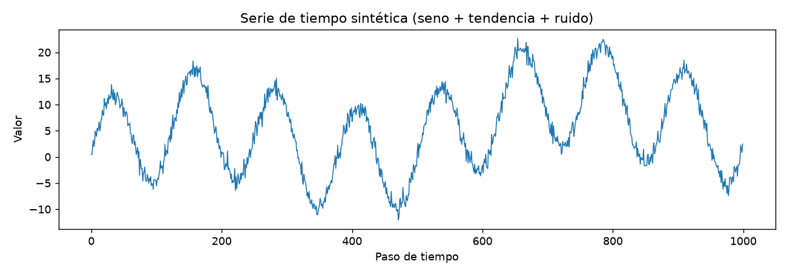
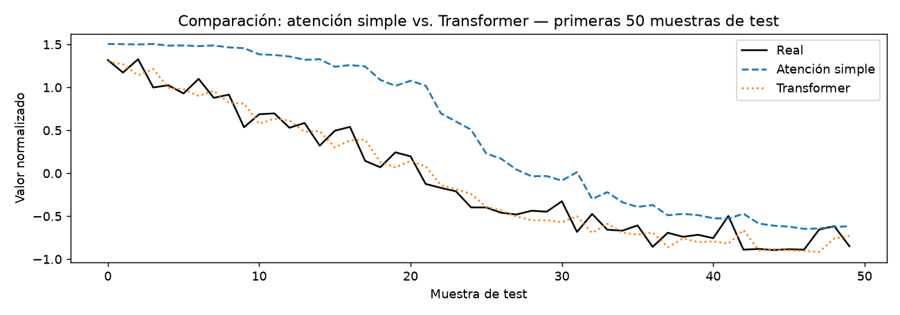
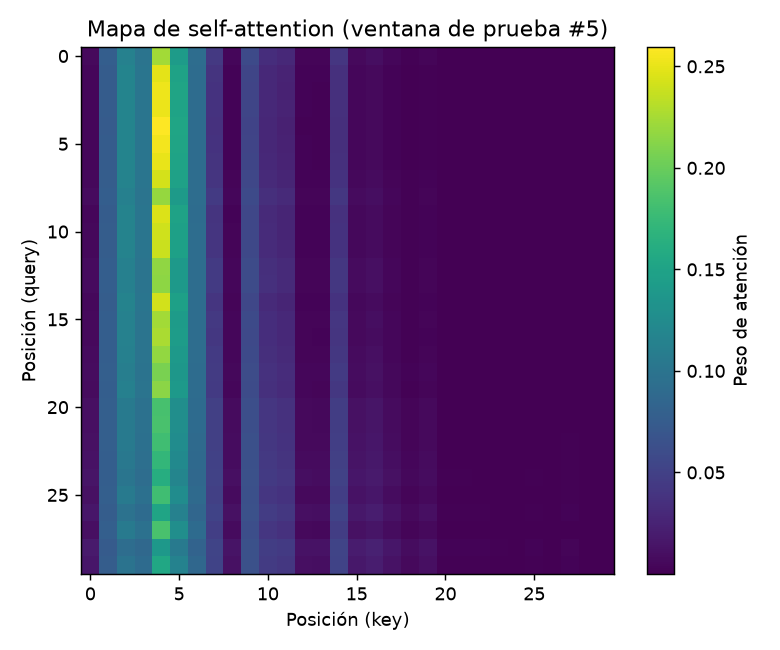

<div align="center">

# Mecanismo de Atención y Transformer Básico para Series de Tiempo

Implementación desde cero de **self-attention** y de un **Transformer encoder** (PyTorch), comparados sobre la misma tarea de predicción de series de tiempo.


</div>

---

## Tabla de contenido

- [Descripción general](#descripción-general)
- [Arquitectura implementada](#arquitectura-implementada)
- [Datos](#datos)
- [Resultados](#resultados)
- [Estructura del repositorio](#estructura-del-repositorio)
- [Cómo ejecutar](#cómo-ejecutar)
- [Referencias](#referencias)

## Descripción general

Este proyecto implementa y compara, sobre la misma tarea de predicción de una serie de tiempo:

1. Un mecanismo de **self-attention** construido desde cero (proyecciones Q/K/V y la fórmula de atención de Vaswani et al., 2017), sin usar ningún bloque preconstruido.
2. Un **Transformer encoder básico**, con atención multi-cabeza, codificación posicional senoidal, capas feed-forward y normalización.

El objetivo es responder, con código y resultados reales, una pregunta concreta: **¿qué le aporta la arquitectura Transformer completa frente a un mecanismo de atención aislado?**

Desarrollado como parte de la actividad académica *R2-A3-S12 Transformers* (Deep Learning - Conceptos).

## Arquitectura implementada

```
Serie de tiempo (1000 pasos)
        │
        ▼
Ventanas deslizantes (30 pasos → 1 predicción)
        │
   ┌────┴─────────────────────────┐
   ▼                              ▼
Self-Attention (1 cabeza)    Transformer Encoder
 Q, K, V manuales             • Atención multi-cabeza (4)
 softmax(QK^T/√d_k)·V          • Codificación posicional
 + capa lineal                 • Feed-forward + residual + norm
   │                              │
   ▼                              ▼
   MSE test: 0.191              MSE test: 0.021
```

## Datos

Serie de tiempo **sintética** (seno + tendencia + ruido), generada con semilla fija para garantizar reproducibilidad total, sin depender de ningún dataset externo.

<p align="center">
  
</p>

| Parámetro | Valor |
|---|---|
| Longitud de la serie | 1000 pasos |
| Tamaño de ventana | 30 pasos |
| Horizonte de predicción | 1 paso |
| Ventanas de entrenamiento | 776 |
| Ventanas de prueba | 194 |

## Resultados

| Modelo | Épocas | MSE train | MSE test |
|---|---|---|---|
| Self-attention (1 cabeza) | 150 | 0.152 | **0.191** |
| Transformer (4 cabezas) | 200 | 0.024 | **0.021** |

El Transformer reduce el error de predicción en casi un orden de magnitud frente a la atención simple.

<p align="center">
  
</p>

### Qué aprende el mecanismo de atención

El mapa de self-attention permite ver exactamente en qué pasos pasados se concentra el modelo al predecir el siguiente valor: no en el más reciente, sino en un grupo de posiciones intermedias.

<p align="center">
  
</p>

Más gráficas (curvas de pérdida, predicción vs. valor real) están disponibles en [`resultados/`](resultados/).

## Estructura del repositorio

```
.
├── Transformers_Series_Tiempo.ipynb   # Notebook ejecutado (Google Colab)
├── experimento.py                     # Script equivalente en Python plano
├── Informe_Transformers_Series_Tiempo.docx / .pdf   # Informe técnico
└── resultados/                        # Gráficas y métricas generadas
    ├── serie_original.png
    ├── attn_loss.png
    ├── attn_heatmap.png
    ├── attn_sobre_pasado.png
    ├── attn_pred_vs_real.png
    ├── tf_loss.png
    ├── tf_pred_vs_real.png
    ├── comparacion_modelos.png
    └── resumen.txt
```

## Cómo ejecutar

```bash
pip install torch numpy matplotlib
python experimento.py
```

También puede abrirse directamente `Transformers_Series_Tiempo.ipynb` en [Google Colab](https://colab.research.google.com/), sin instalación local.

## Referencias

- Vaswani, A., et al. (2017). [*Attention Is All You Need*](https://arxiv.org/abs/1706.03762). NeurIPS.
- Alammar, J. (2018). [*The Illustrated Transformer*](https://jalammar.github.io/illustrated-transformer/).
- Paszke, A., et al. (2019). *PyTorch: An Imperative Style, High-Performance Deep Learning Library*. NeurIPS.

---

<div align="center">
<sub>Joan Schneider Beltrán Delgado · CADI, Universidad de Cundinamarca</sub>
</div>
